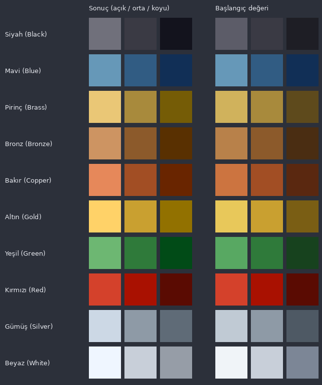

# Dragonborn pul deseni — renk tablosu (önizleme, onay bekliyor)

Üretim: `python scripts/dragonborn-desen-renk.py` (tablo, `renk-tablosu.json`), `python scripts/dragonborn-desen.py` (görseller). Hiçbir oyun dosyası değişmedi.

## Tablo (açık / orta / koyu)

Orta ton = pul gövdesinin baskın rengi; kullanıcı değeri, değiştirilmedi. Kalın değer: başlangıç değerinden ayarlandı.

| Soy | Açık | Orta | Koyu | ΔL* (açık / koyu) | Not |
|---|---|---|---|---|---|
| Siyah (black) | **#70707B** (başl. #5C5C68) | #3A3A44 | **#13131D** (başl. #1E1E25) | +22.8 / −18.5 | — |
| Mavi (blue) | #6698B8 | #315C83 | #112F56 | +22.8 / −18.4 | kullanıcı değeri (sabit) |
| Pirinç (brass) | **#EAC776** (başl. #D0B25C) | #A88A3C | **#755C06** (başl. #5E4A1C) | +22.8 / −18.5 | — |
| Bronz (bronze) | **#CD9462** (başl. #B8814A) | #8C5A2B | **#593001** (başl. #4A2D12) | +22.9 / −18.4 | — |
| Bakır (copper) | **#E6885A** (başl. #CC7440) | #A24E24 | **#692500** (başl. #5A2810) | +22.7 / −18.4 | — |
| Altın (gold) | **#FFD268** (başl. #E8C85A) | #C9A030 | **#927100** (başl. #7A5E14) | +18.3 / −18.5 | açık L* 91 → 86 (kroma korunsun diye) |
| Yeşil (green) | **#6DB772** (başl. #58A862) | #2F7A3A | **#014B17** (başl. #17421E) | +22.9 / −18.4 | — |
| Kırmızı (red) | #D4412B | #A91101 | #5A0B02 | +13.8 / −18.1 | kullanıcı değeri (sabit) |
| Gümüş (silver) | **#CCD8E5** (başl. #C0CAD4) | #8E9AA6 | **#5F6B77** (başl. #4E5964) | +22.8 / −18.4 | — |
| Beyaz (white) | **#EFF6FF** (başl. #F0F4F8) | #C8CFD9 | **#969DA7** (başl. #7C8696) | +13.7 / −18.4 | açık L* 97 → 96 (kroma korunsun diye); açık L* 106 → 97 (tavan; aralık daraldı) |

## Eşitleme yöntemi

- Mavi referansın (ejderha görselinin pul bölgesinden ölçülen) aralığı CIE L* farkı olarak alındı: açık = orta + 22,8, koyu = orta − 18,4. HSL açıklığıyla bu, açık ≈ 1,59×, koyu ≈ 0,57× orta (istenen 1,7× / 0,5×'e en yakın tutarlı ölçü; düz "parlaklık ×1,7" açık soylarda 1'i aşıyor).
- Ton (h) korunur. Kroma mavideki oranla (açık 0,88×, koyu 1,03×) ama açıkta en az orta kroma: açık ton beyaza karışmaz. sRGB gamına sığmazsa koyuda kroma, açıkta önce L* kısılır.
- Kırmızı ve mavi sabit (kullanıcı değeri). Kırmızının kendi aralığı +13,8 / −18,1: açık tonu mavininkinden daha dar (eşitlenirse açık ≈ #E86343 olur; sabit dendiği için dokunulmadı).
- Beyaz: açık L* 106 olurdu, tavan 97 → aralık +13,7'ye daraldı (beyazda daha açık ton yok). Altın: kroma korunsun diye açık L* 91 → 86.
- Başlangıç değerlerinin koyu tonları mavininkinden açıktı (ör. pirinç #5E4A1C ΔL −24, altın #7A5E14 −29 yerine −18,4); eşitlemeyle hepsi aynı kontrasta geldi. Koyu tonlarda gam sınırı yüzünden yeşil #014B17, bronz #593001 neredeyse saf ton; istenirse kroma bir tık düşürülebilir.

## Oyundaki Dragonborn renk tablosuyla karşılaştırma (Ek 2, değiştirilmedi)

Oyunda beyaz taban jetonlar `data/soy-renkleri.json` `dragonborn.lineagesAlt.<soy>.multiply.renk` (çarpma rengi) ile boyanıyor; yedek maske yolu `lineagesAltMaske` (LCh), kanat `data/kanat-esleme.json` `renkPaletleri`. Çarpma rengi tene çarpıldığı için açıklığı yüksek; asıl karşılaştırma ton (h) ve kroma (C).

| Soy | Senin orta | Oyun çarpma rengi | Ton farkı | Durum |
|---|---|---|---|---|
| Mavi | #315C83 (h 265, C 26: çelik mavisi) | #5f84e8 (h 287, C 57: canlı kraliyet mavisi) | 22° | **çelişiyor**: oyunda mor-mavi ve iki kat doygun; kanat paleti de #7c9aec |
| Beyaz | #C8CFD9 (gri-mavi, L* 83) | #ffffff (boyasız) | — | **çelişiyor**: oyunda Beyaz soy boyanmıyor (jeton olduğu gibi); desenle gri-mavi pullu olur |
| Kırmızı | #A91101 (h 41, koyu kan kırmızısı) | #e4524c (h 31, mercan/kiremit) | 10° | hafif: oyundaki daha pembe-mercan |
| Siyah | #3A3A44 (h 292, morumsu) | #5b606e (h 279); maske yolu h 262 | 13° / 30° | hafif: oyundaki daha mavimsi gri |
| Gümüş | #8E9AA6 (h 257) | #c4cad6 (h 272) | 15° | hafif |
| Pirinç, Bronz, Bakır, Altın, Yeşil | — | — | ≤ 3° | uyumlu |
